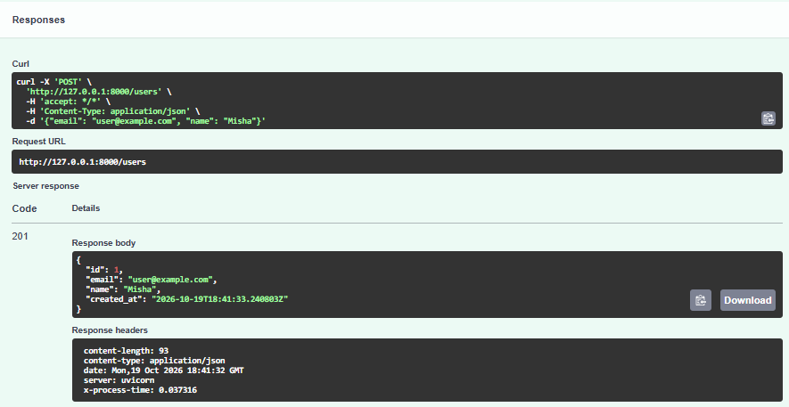
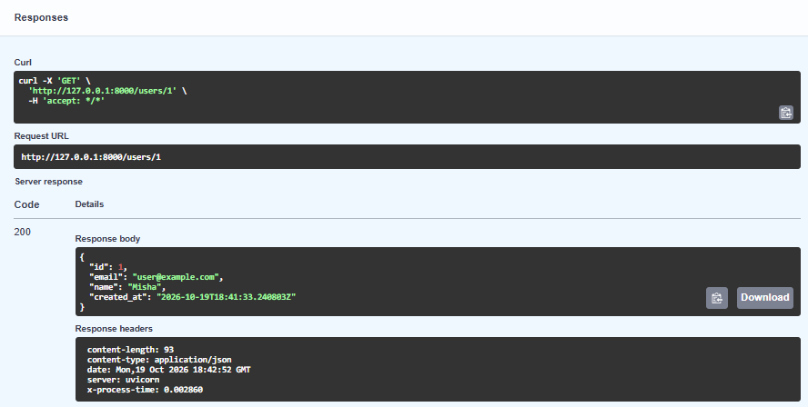
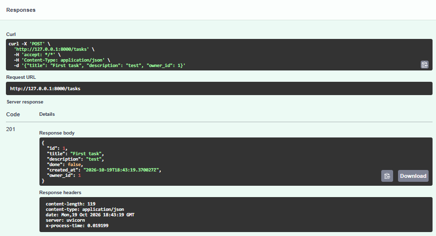
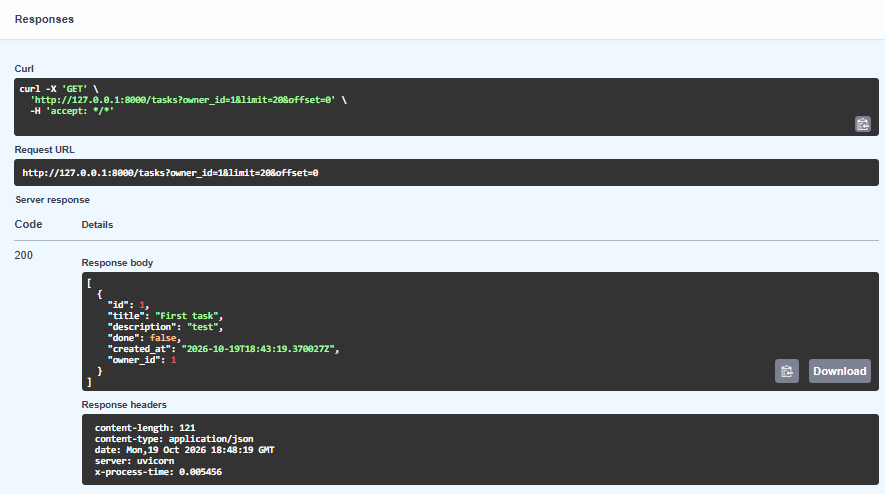
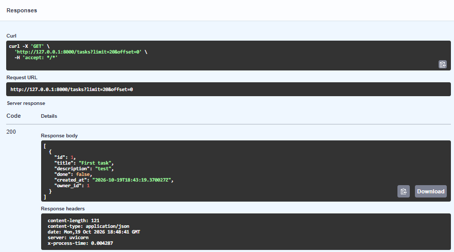
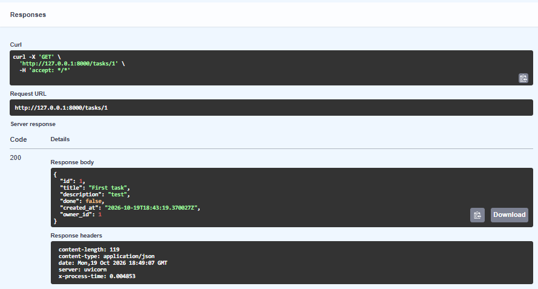
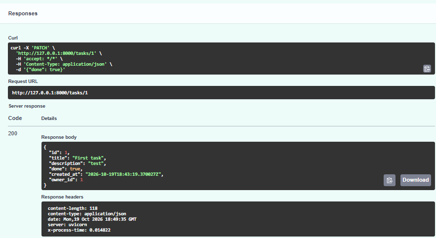
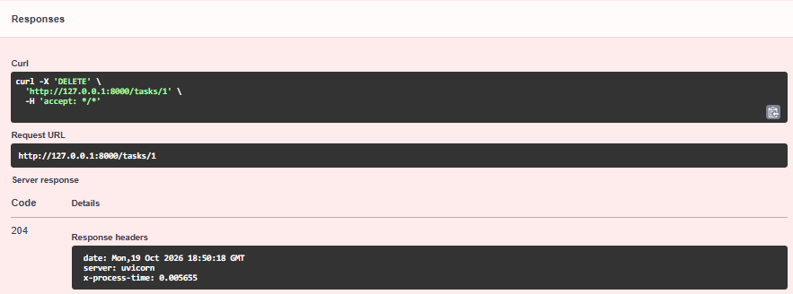
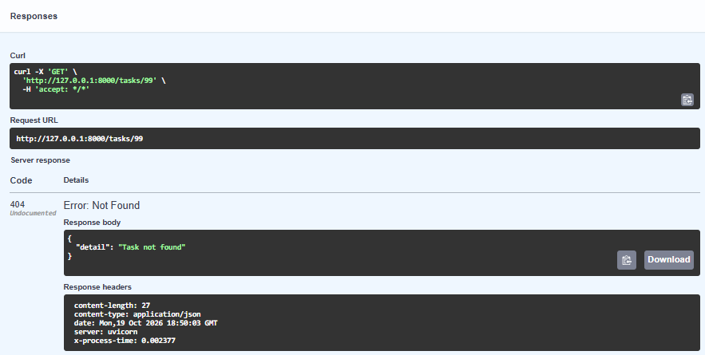
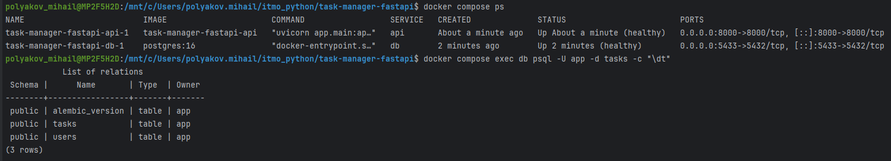

# Менеджер задач: REST API на FastAPI

Практическая работа № 2. Сервис хранит пользователей и их задачи.

## Структура проекта

```
app/
    __init__.py
    main.py          создание приложения, middleware, подключение роутеров
    config.py        настройки (pydantic-settings), DATABASE_URL из окружения
    db.py            движок, фабрика сессий, Base, зависимость get_session
    models.py        ORM-модели User и Task
    schemas.py       Pydantic-схемы *Create, *Read, *Update
    routers/
        users.py
        tasks.py
migrations/          Alembic (шаблон async)
alembic.ini
Dockerfile
docker-compose.yml
requirements.txt
.env.example
```

## Инструкция по запуску

Требования: Docker и Docker Compose, Git. Python на машине устанавливать не нужно: приложение и PostgreSQL работают в контейнерах.

1. Клонировать репозиторий и перейти в каталог проекта:

```bash
git clone https://github.com/mishapolyakov111/task-manager-fastapi.git
cd task-manager-fastapi
```

2. Создать файл с настройками из примера:

```bash
cp .env.example .env
```

В `.env` задаётся порт базы на хосте (`DB_PORT`, по умолчанию 5432). Строка подключения `DATABASE_URL` не хранится в коде, её передаёт в контейнер приложения `docker-compose.yml` через переменную окружения:

```
DATABASE_URL=postgresql+asyncpg://app:app@db:5432/tasks
```

3. Поднять всё одной командой:

```bash
docker compose up -d --build
```

Порядок запуска задают healthcheck и зависимости в `docker-compose.yml`:

- `db` стартует первой, её готовность проверяет healthcheck (`pg_isready`);
- `migrate` ждёт состояния healthy у `db`, при первом запуске создаёт миграцию автогенерацией (если в `migrations/versions/` ещё нет файлов) и применяет `alembic upgrade head`, после чего завершается;
- `api` стартует только после успешного завершения `migrate` и сама проверяется healthcheck-ом по адресу `/docs`.

Таблицы создаются только миграциями. Созданный файл миграции появляется в `migrations/versions/` на хосте, его нужно закоммитить.

5. Открыть Swagger UI: http://127.0.0.1:8000/docs

Логи приложения, включая строки middleware: `docker compose logs -f api`. Остановить всё: `docker compose down`.

## Эндпоинты

| Метод | Путь | Описание | Коды ответа |
|-------|------|----------|-------------|
| POST | /users | создать пользователя | 201, 409 (email занят), 422 |
| GET | /users/{id} | получить пользователя | 200, 404 |
| POST | /tasks | создать задачу | 201, 404 (нет владельца), 422 |
| GET | /tasks | список задач, фильтры done, owner_id, пагинация limit (1-100), offset | 200 |
| GET | /tasks/{id} | получить задачу | 200, 404 |
| PATCH | /tasks/{id} | частично обновить задачу | 200, 404, 422 |
| DELETE | /tasks/{id} | удалить задачу | 204, 404 |

Middleware добавляет в каждый ответ заголовок `X-Process-Time` и пишет в лог метод, путь, статус и время обработки запроса.

## Скриншоты

### Успешные запросы в Swagger UI

POST /users, 201:



GET /users/{id}, 200:



POST /tasks, 201:



GET /tasks с фильтром owner_id=1, 200:



GET /tasks без фильтров, 200:



GET /tasks/{id}, 200:



PATCH /tasks/{id}, 200:



DELETE /tasks/{id}, 204:



### Ответ 404

GET /tasks/{id} для несуществующей задачи:



### Таблицы в БД (\dt в psql)



## Ответы на контрольные вопросы

**1. Чем FastAPI отличается от Starlette и какие компоненты Starlette он использует?**

Starlette это лёгкий ASGI-фреймворк: маршрутизация, запросы и ответы, middleware, WebSocket, статические файлы, события жизненного цикла. FastAPI построен поверх Starlette (класс `FastAPI` наследуется от `Starlette`) и добавляет к нему то, чего там нет: валидацию и сериализацию данных через Pydantic по аннотациям типов, систему внедрения зависимостей (`Depends`), автоматическую генерацию схемы OpenAPI и интерактивной документации (Swagger UI, ReDoc), удобные инструменты для параметров запроса, тела, заголовков и безопасности. От Starlette FastAPI использует ASGI-основу, роутинг (`APIRouter` расширяет `Router` Starlette), объекты `Request` и `Response`, механизм middleware (в этой работе `@app.middleware("http")`), обработку исключений, фоновые задачи, WebSocket и `TestClient`.

**2. Зачем разделять схемы Create, Read и Update?**

У одной сущности разные наборы полей и правила в разных операциях. В `Create` есть только то, что задаёт клиент, и часть полей обязательна. В `Read` есть поля, которые генерирует сервер (`id`, `created_at`), и в него не попадает ничего лишнего или секретного. В `Update` все поля необязательны, чтобы поддержать частичное обновление через PATCH. Единая схема позволила бы клиенту передать `id` или `created_at`, заставляла бы отправлять все поля при обновлении и усложняла бы документацию. Раздельные схемы делают контракт API явным, защищают от записи служебных полей и дают точную схему в Swagger.

**3. Что делает from_attributes=True?**

Параметр `ConfigDict(from_attributes=True)` разрешает Pydantic строить модель не только из словаря, но и из произвольного объекта, читая значения через атрибуты (`obj.id`, `obj.title`). Благодаря этому схема `*Read` напрямую принимает ORM-объект SQLAlchemy, и FastAPI может сериализовать его по `response_model` без ручного преобразования в словарь. В Pydantic v1 для этого использовался `orm_mode = True`.

**4. Почему сессия передаётся через Depends, а не создаётся глобально?**

Сессия SQLAlchemy хранит состояние: транзакцию, соединение, идентификационную карту объектов. Она не потокобезопасна и не рассчитана на одновременное использование из нескольких запросов. Глобальная сессия разделялась бы между всеми конкурентными запросами, смешивала бы их транзакции, держала бы соединение и накапливала устаревшие объекты. Зависимость `get_session` с `yield` создаёт отдельную сессию на каждый запрос и гарантированно закрывает её после ответа (в том числе при исключении), возвращая соединение в пул. Кроме того, зависимость легко подменяется в тестах через `app.dependency_overrides`.

**5. Чем exclude_unset=True отличается от exclude_none=True?**

`exclude_unset=True` исключает поля, которые клиент не передавал при создании модели, независимо от их значения. Явно переданное `null` остаётся в результате. `exclude_none=True` исключает все поля со значением `None`, независимо от того, передали их или нет. Для PATCH нужен `exclude_unset=True`: он позволяет отличить отсутствующее поле (не трогать) от поля, явно присланного как `null` (например, очистить `description`). Если использовать `exclude_none=True`, очистить поле в `None` будет невозможно. В этой работе для обязательных полей `title`, `done` и `owner_id` явный `null` дополнительно отклоняется валидатором с кодом 422.

**6. Почему в production таблицы не создают через create_all?**

`create_all` умеет только создавать отсутствующие таблицы: он не изменяет существующие (не добавляет и не удаляет столбцы, не меняет типы и ограничения), не хранит историю изменений схемы и не умеет откатываться. При изменении моделей схема в production разойдётся с кодом, а править её придётся вручную. Миграции Alembic версионируют схему, применяются по порядку и воспроизводимо на каждом окружении, поддерживают откат (`downgrade`), позволяют ревьюить изменения как код и безопасно переносить данные. Кроме того, создание таблиц при старте приложения смешивает ответственность и требует лишних прав БД у приложения.
